<p align="center">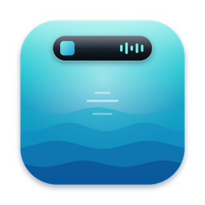</p>

<h1 align="center">Lagoon</h1>

<p align="center">
  <b>A free Dynamic Island for the Mac notch.</b><br>
  Music, calendar, timers, notifications, files, calls, AI agents and a plugin marketplace — living around your notch.
</p>

<p align="center">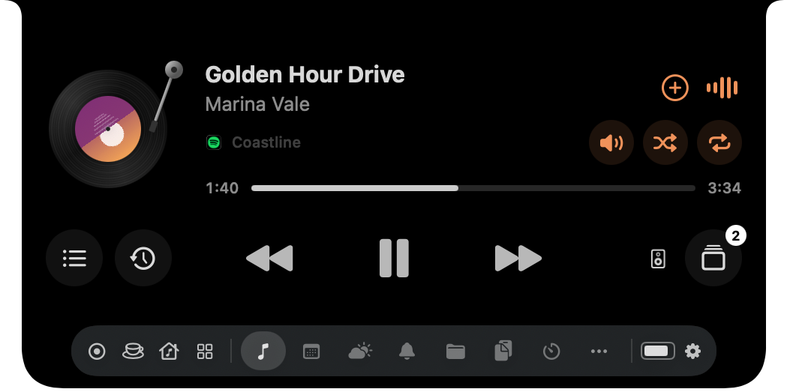</p>

---

## Contents

- [What is Lagoon?](#what-is-lagoon)
- [Requirements](#requirements)
- [Install](#install)
- [Updates](#updates)
- [First run and permissions](#first-run-and-permissions)
- [How it works](#how-it-works)
- [The Lagoons](#the-lagoons)
- [Live activities on the closed island](#live-activities-on-the-closed-island)
- [Drop files on the notch](#drop-files-on-the-notch)
- [Plugins and the Marketplace](#plugins-and-the-marketplace)
- [Music Widget and menu bar player](#music-widget-and-menu-bar-player)
- [Spotify](#spotify)
- [Keyboard shortcuts and gestures](#keyboard-shortcuts-and-gestures)
- [Settings](#settings)
- [Privacy](#privacy)
- [Troubleshooting](#troubleshooting)
- [Acknowledgements](#acknowledgements)
- [Feedback](#feedback)
- [License](#license)

---

## What is Lagoon?

Lagoon turns the notch of your MacBook (or the top centre of any display without a notch) into a small, animated **island**. When closed it shows what is happening right now — the song playing, a running timer, an incoming call, a new notification. Hover over it or click it and it opens into a bigger panel called a **Lagoon**, where you can control everything without leaving what you are doing.

- **Free**, written in Swift and SwiftUI, native to macOS.
- Works on **MacBooks with a notch** and on **displays without one** (external monitors, iMac, Mac mini), with an island on every screen you choose.
- **Black** or **Liquid Glass** look, smooth spring animations, fully configurable sizes.
- Extensible with **plugins**: a built-in Marketplace with native and JavaScript plugins.

Each feature lives in its own **Lagoon** — a clean, focused view inside the island — and you move between Lagoons with the bar at the bottom of the island or by swiping.

## Requirements

| | |
|---|---|
| macOS | 14 Sonoma or later (Liquid Glass needs macOS 26) |
| Mac | Any Mac. A notch is optional |

## Install

Open **Terminal** and paste:

```bash
curl -fsSL https://raw.githubusercontent.com/jpclopes99/Lagoon/main/install.sh | bash
```

It downloads the latest version, puts **Lagoon** in your Applications folder and opens it.

Prefer to do it by hand? Download `Lagoon.zip` from the [latest release](https://github.com/jpclopes99/Lagoon/releases/latest), unzip it and drag **Lagoon** to Applications. The first time, macOS says it can't verify the developer: open **System Settings → Privacy & Security** and click **Open Anyway** (only once).

To uninstall, quit Lagoon from its menu bar icon and move it from Applications to the Trash.

Lagoon lives in the **menu bar** (no Dock icon). To open it at login, turn on **Settings → General → Open at login**.

## Updates

Lagoon updates itself. It checks for new versions when it opens, when you unlock your Mac and once a day. When there is one, a notice appears on the island (and in Notification Center) with an **Install** button: Lagoon downloads it, replaces itself and reopens, keeping your settings and permissions. Installed plugins are updated together with the app.

- Check by hand: **Check for Updates…** in the menu bar icon, or **Settings → General → Updates**.
- Turn automatic checks or automatic installs on or off in **Settings → General → Updates**.
- Every update is signed: Lagoon only installs versions published by its author.

## First run and permissions

macOS asks for permissions the first time a feature needs them. Everything is optional: a feature without its permission simply stays off.

| Permission | Used for |
|---|---|
| **Accessibility** | Notifications and calls on the island, replacing the volume/brightness HUD, Window Snap, meeting controls (mute, camera) and media keys |
| **Automation** (Spotify, Music, browsers, System Events) | Reading and controlling music and browser tabs |
| **Calendars and Reminders** | Upcoming events, meeting alerts and reminders |
| **Location** | Local weather (or type a city in Settings) |
| **Contacts** | Photos on notification avatars |
| **Bluetooth** | Battery of headphones, mice and keyboards; connect/disconnect alerts |
| **Screen Recording** | The Record Lagoon and screen captures in the Action Ring |
| **Camera** | The "Am I ready?" mirror before calls |
| **Notifications** | Timer finished alerts |

You can review all of them in **Settings → Permissions**.

## How it works

- **Closed island** — sits around the notch and shows the current activity: artwork and a waveform for music, a ring for timers, a green wave during calls, and so on. Extra activities appear as small **bubbles** next to the island (1 to 6, split between both sides).
- **Open island** — hover (or click) to open it. It opens on the activity in the middle of the island; if there is none, on the last Lagoon you chose (or a fixed Lagoon from Settings).
- **Lagoons bar** — the bar at the bottom of the open island lists every Lagoon. Lagoons that don't fit go to a `•••` page. You can show it always or only when the mouse reaches the bottom of the island.
- **Swipe** with two fingers to move between Lagoons (a long swipe skips several).
- **Right-click** the island for quick options (vinyl cover, Settings).

## The Lagoons

Screenshots of the real app.

### Music

| Vinyl cover | Normal cover |
|---|---|
|  | 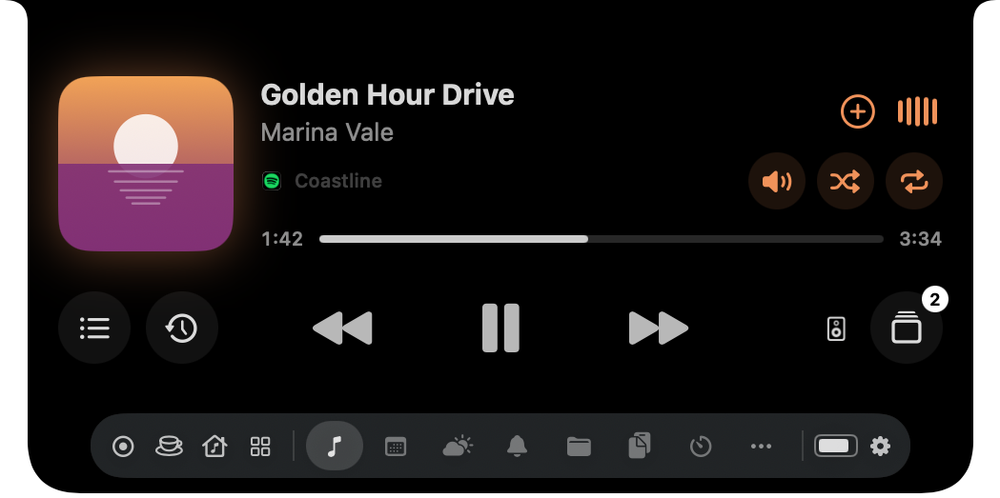 |

Works with **any player**: Spotify, Apple Music, YouTube Music, and video or music playing in **Chrome, Safari, Edge, Brave, Arc, Firefox** and other browsers (YouTube, Netflix, Prime Video, podcasts…).

- Big controls, clickable progress bar, shuffle, repeat (all / one), volume, audio output picker.
- **Players** button: every app and browser tab that is playing, so you can switch between them.
- **Up Next** queue (Spotify, Apple Music, YouTube and YouTube Music), with drag to reorder.
- **Recents** — the albums, playlists and Liked Songs you played recently on Spotify, one click to play.
- **Like** button for Spotify (works both ways with the Spotify app) and Apple Music.
- Spotify's Up Next, Like and Recents need a free Spotify app of your own — see [Spotify](#spotify).
- **Vinyl cover**: the artwork becomes a spinning record with a tonearm (slow, medium or fast).
- **Sneak Peek**: when the song changes, the title and artist appear under the notch for a moment.

### Calendar

<p>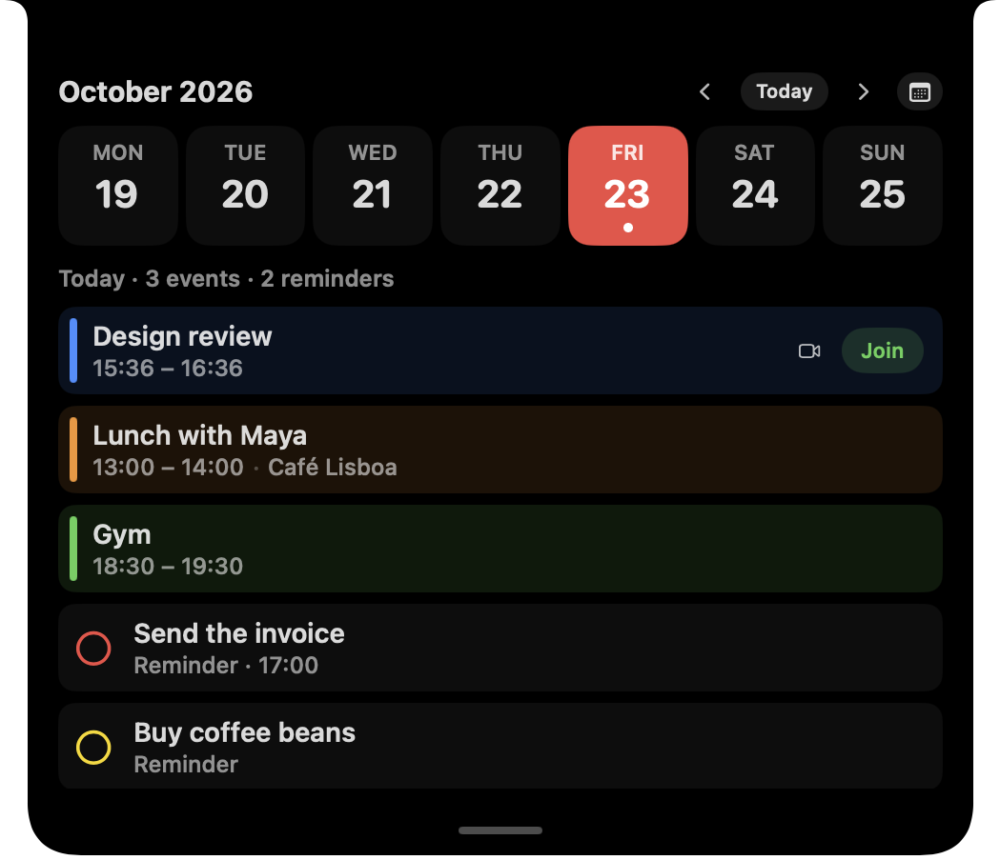</p>

The week at a glance, today's events and **reminders** (tick them off), a full month view, and a **meeting alert** 5 minutes before with a **Join** button for Zoom, Google Meet, Teams and others.

### Weather

<p>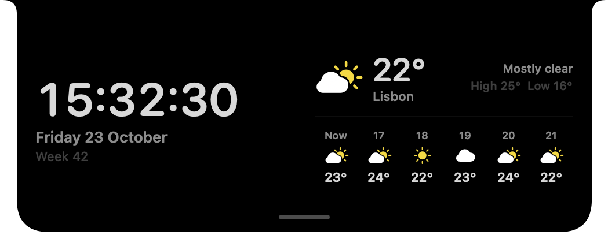</p>

A large clock with the date and week number, the current weather and the next hours (from Open-Meteo, free).

### Notifications

<p>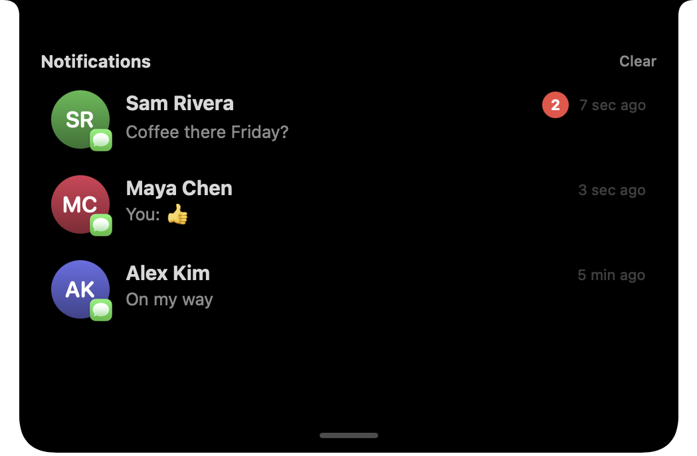</p>

Banners from other apps land on the island, with contact photos or initials, history and **quick reply** in Messages.

### Clip (file shelf)

<p>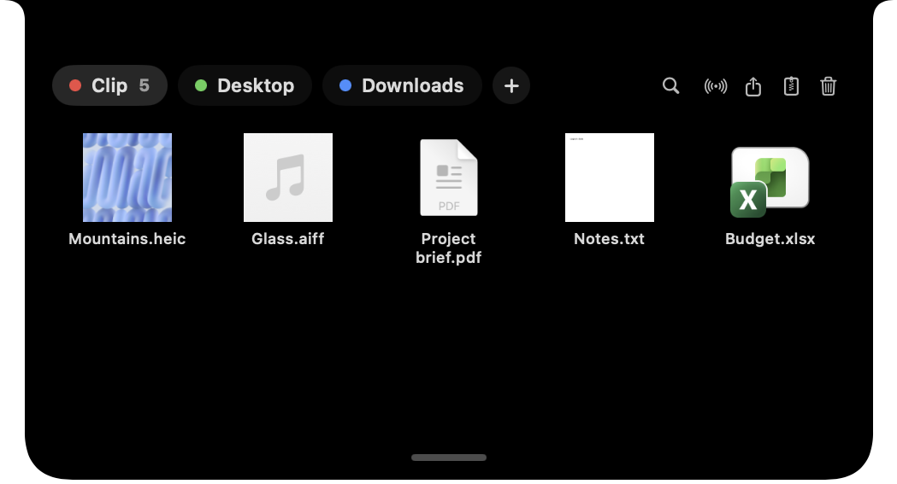</p>

Keep files at hand: drop them on the notch, drag them out later. Quick folders (Desktop, Downloads, your own), Quick Look, compress, AirDrop, iCloud link and more.

### Clipboard

<p>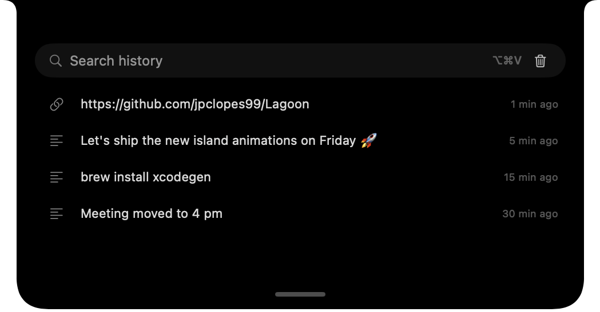</p>

Searchable clipboard history (**⌥⌘V**). Passwords are ignored.

### Timers

<p>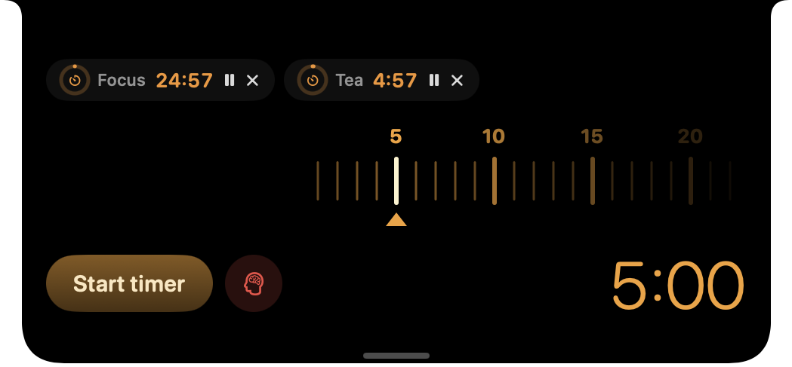</p>

Pick a duration on a ruler (drag or scroll) and run several timers at once, plus a Pomodoro focus timer. **⌘ + click** on the notch or **⌥⌘T** starts a quick timer.

### Devices

<p>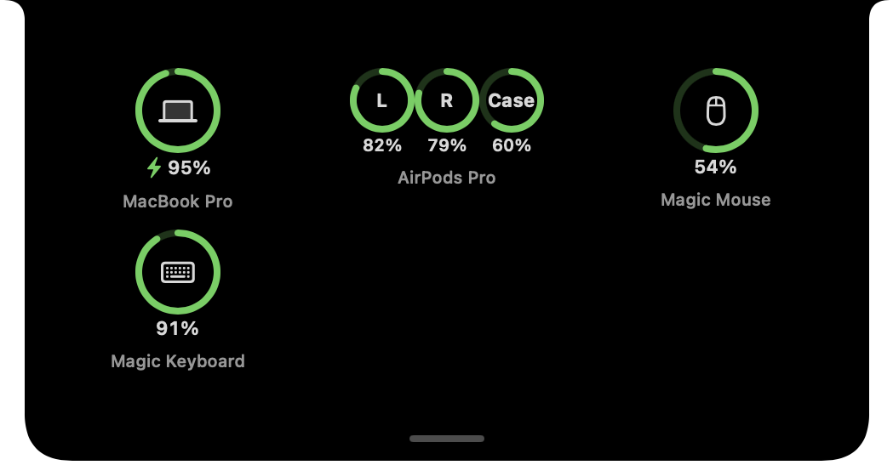</p>

Battery of the Mac and every Bluetooth device — left, right and case for earbuds.

### Record

<p>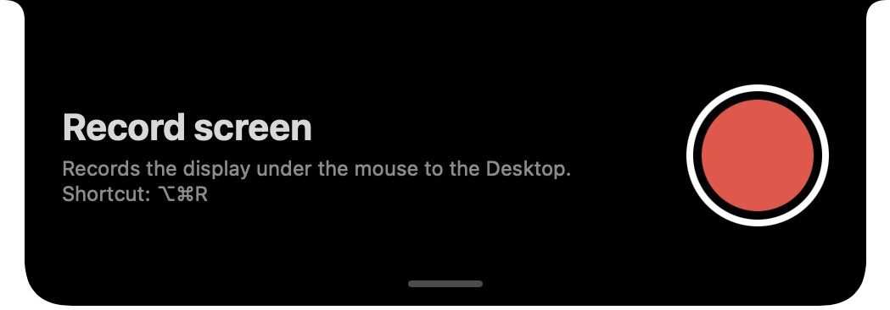</p>

Records the display under the mouse to the Desktop. **⌥⌘R** starts and stops; an optional record button sits in the Lagoons bar.

### Call

<p>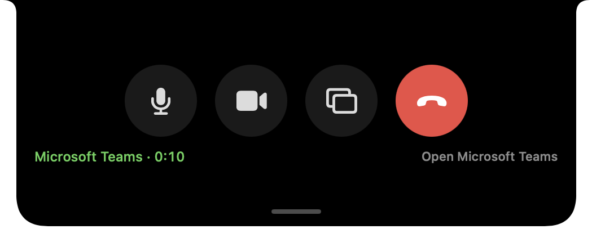</p>

During a Teams or Zoom call: mute, camera, screen sharing and leave, showing the app's real state (Teams and Zoom plugins). FaceTime and iPhone calls can be answered on the island.

### Stay Awake

<p>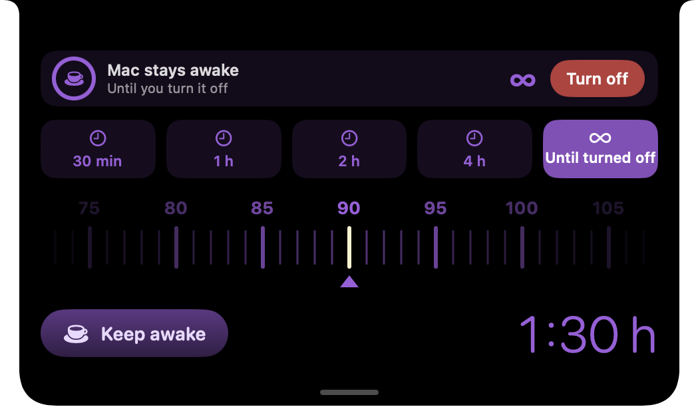</p>

Keeps the Mac (and the display) awake for 30 min, 1 h, 2 h, 4 h, a custom time on the ruler, or until you turn it off. **⌥⌘A** toggles it; a cup button can live in the Lagoons bar. It survives restarting Lagoon.

### Shortcuts

<p>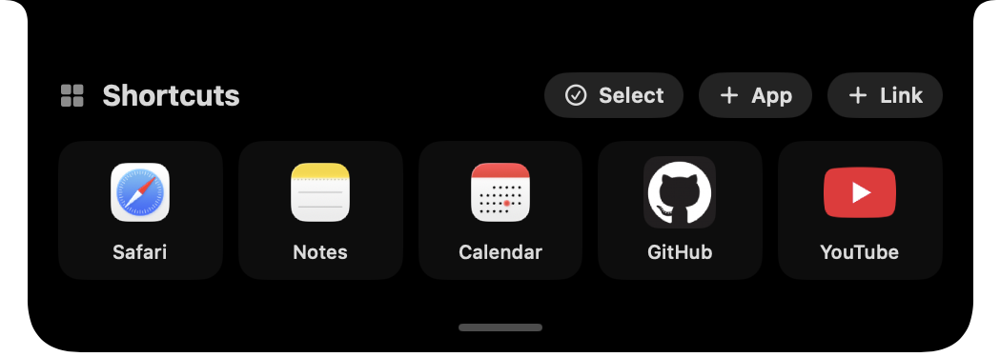</p>

Your favourite apps and links. Pick apps inside the island, add links with the browser they should open in, drag to reorder, select several to remove, and send any of them to the Action Ring.

### Agents

<p>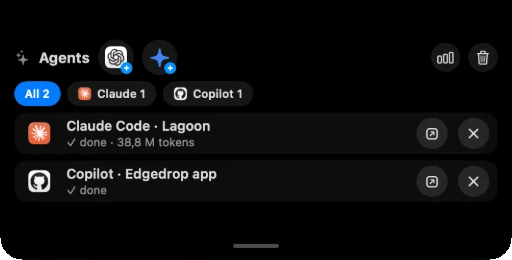</p>

Claude Code, Codex, Gemini CLI and GitHub Copilot sessions: what is working, what needs you, subagents, filters per AI and usage/plan limits.

### Terminal

<p>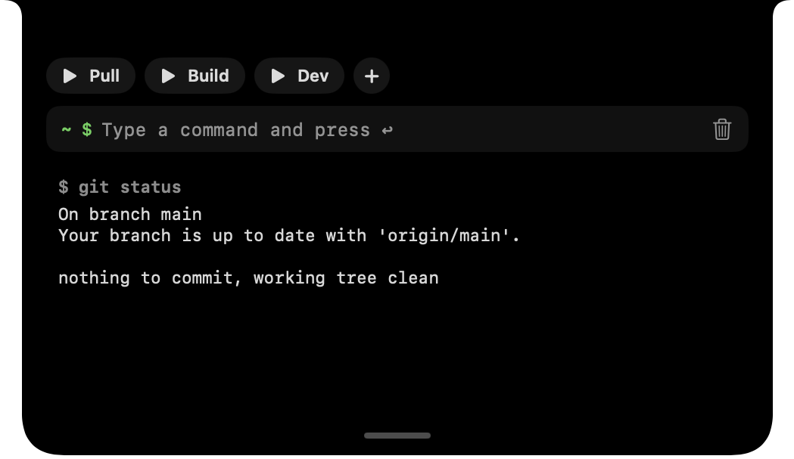</p>

Saved shell commands as buttons and a command line, with the output on the island.

### Audio

<p>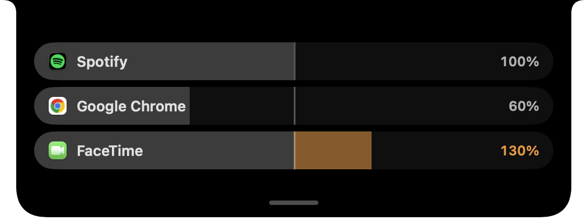</p>

A separate volume for every app that is playing (0–200 %).

### System

<p>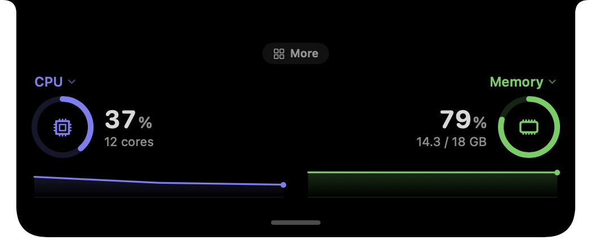</p>

CPU, memory, GPU, disk, network, battery and temperature, with live graphs; choose which ones and how many.

### Downloads

<p>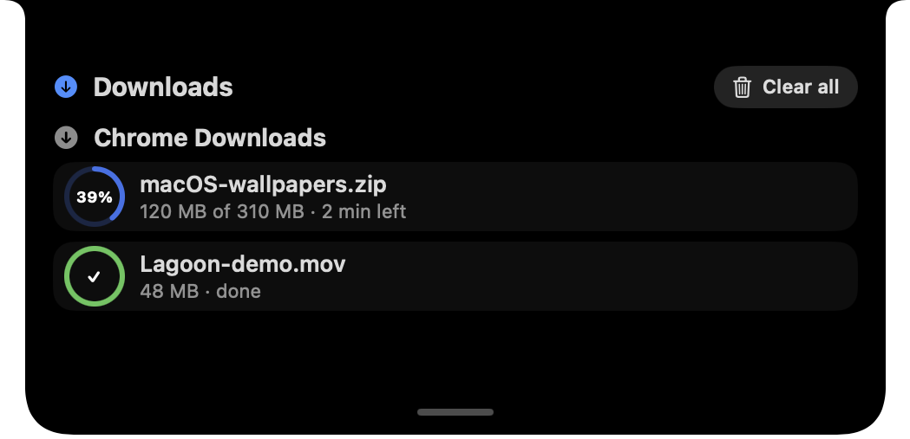</p>

Browser downloads with progress (Chrome, Safari and Firefox plugins).

### Camera

<p>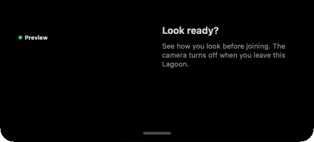</p>

"Look ready?" — a mirror before a call, with the next meeting and a button to join it. The camera turns off when you leave the Lagoon.

Lagoons from plugins only appear when the plugin is installed. You can hide, show and reorder Lagoons in **Settings → Appearance**.

## Live activities on the closed island

When something is happening, the closed island shows it around the notch. Several activities at once sit **side by side** in bubbles next to the island.

<p></p>

| Activity | What you see |
|---|---|
| 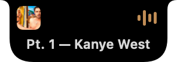 | **Song changed** — title and artist under the notch |
|  | **Timers running** — time left; the badge counts timers |
|  | **Screen recording** — red dot and elapsed time |
| 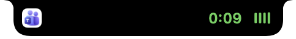 | **Teams / Zoom meeting** — app icon, call time and audio wave |
|  | **AI agent working** — Claude Code, Codex, Gemini or Copilot, with how long |
|  | **AI agent waiting for you** |
| 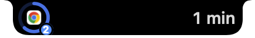 | **Download progress** — browser icon, ring and time left |
|  | **Stay Awake** — time left (or ∞) |
|  | **Keyboard input source changed** (US, PT…) |
|  | **Caps Lock** on/off |
|  | **Microphone in use**, with the app using it |
| 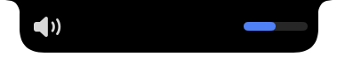 | **Volume** — optionally instead of the macOS HUD |
| 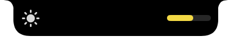 | **Brightness** |
| 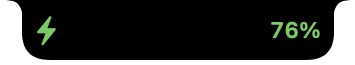 | **Charging** |
| 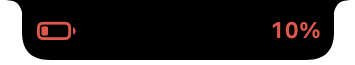 | **Low battery** |
|  | **Copied** to the clipboard |
| 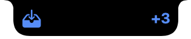 | **Added to Clip** |
|  | **Files converted** |
|  | **Timer finished** |

Bigger alerts open under the notch:

| | |
|---|---|
| 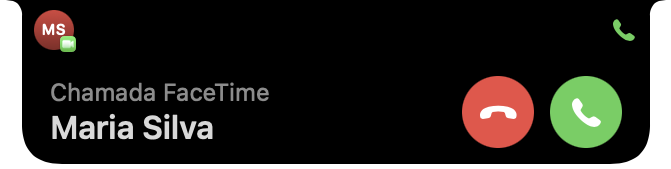 | **Incoming call** (FaceTime / iPhone) — answer or decline on the island |
| 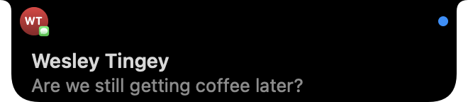 | **Notification** — avatar, app icon and the message |
| 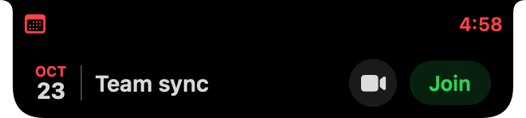 | **Meeting soon** — countdown and **Join** |
| 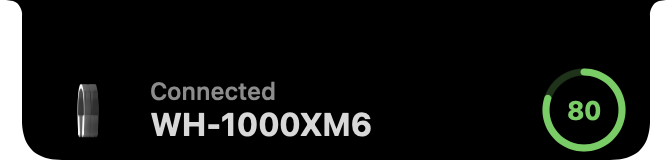 | **Device connected** — headphones, mouse or keyboard with battery |
| 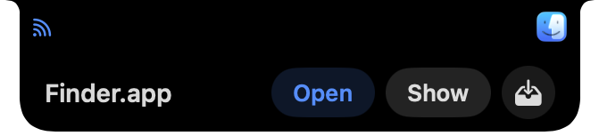 | **AirDrop received** — open, show in Finder or keep on the shelf |
| 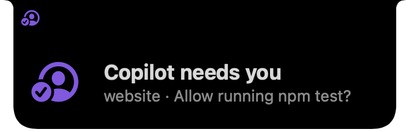 | **Plugin alerts** — e.g. an AI agent that needs you |

## Drop files on the notch

<p>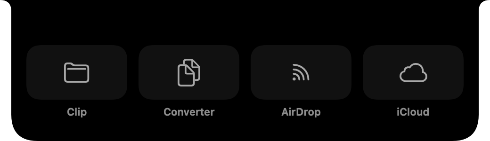</p>
<p>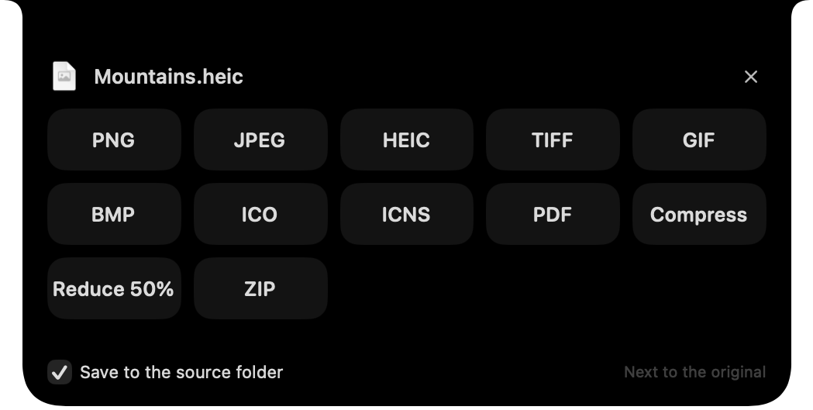</p>

Drag any file to the notch and four targets appear:

- **Clip** — keep it on the shelf.
- **Converter** — offline conversion: images (PNG, JPEG, HEIC, TIFF, GIF, BMP, ICO, ICNS, PDF, compress, 50%), audio (M4A, ALAC, WAV, AIFF, CAF), video (MP4, MOV, M4V, 720p, compress, GIF, audio only), PDF (text, images, compress), documents (PDF, DOCX, DOC, RTF, TXT, HTML, ODT, and Office files through Pages/Numbers/Keynote) and ZIP for anything.
- **AirDrop** — send it.
- **iCloud** — upload it and copy a share link.

## Plugins and the Marketplace

Open **Settings → Plugins**. The **Installed** tab lists your plugins (turn them on/off, options, remove); the **Marketplace** tab lets you search and install more.

### Action Ring

<p>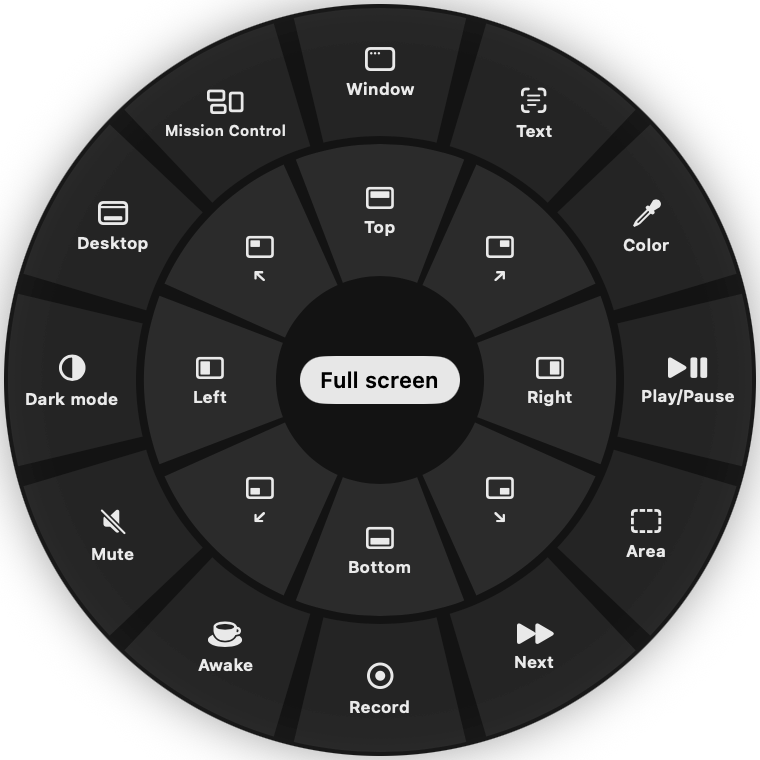</p>

A ring of actions around the cursor (default **⌥⇥**, recordable). Window layouts in the inner ring; up to 12 actions outside — screenshots, colour picker, text grab, media, system actions, apps, macOS Shortcuts, links and your Shortcuts items. Drag to reorder in Settings.

### Shortcuts

<p></p>

A Lagoon with favourite apps and links: pick apps inside the island, add links with the browser they open in, drag to reorder, select several to remove, and a quick button in the Lagoons bar.

### Music Widget

| | Vinyl cover | Normal cover |
|---|---|---|
| **Small** |  |  |
| **Medium** | 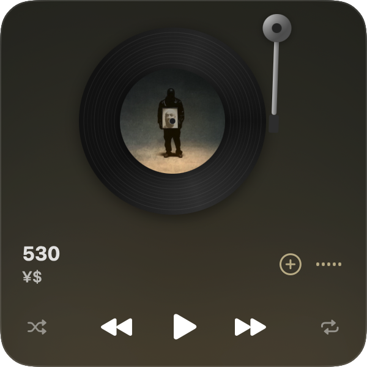 | 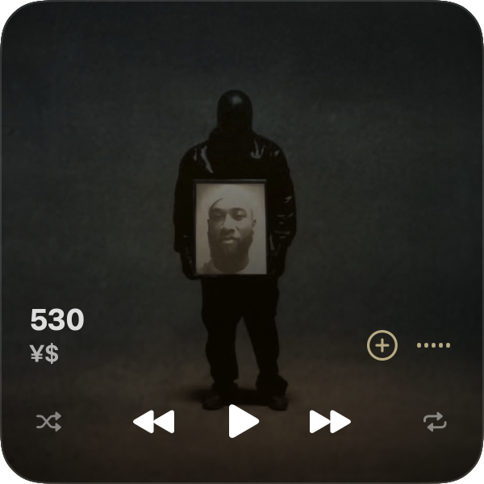 |
| **Large** | 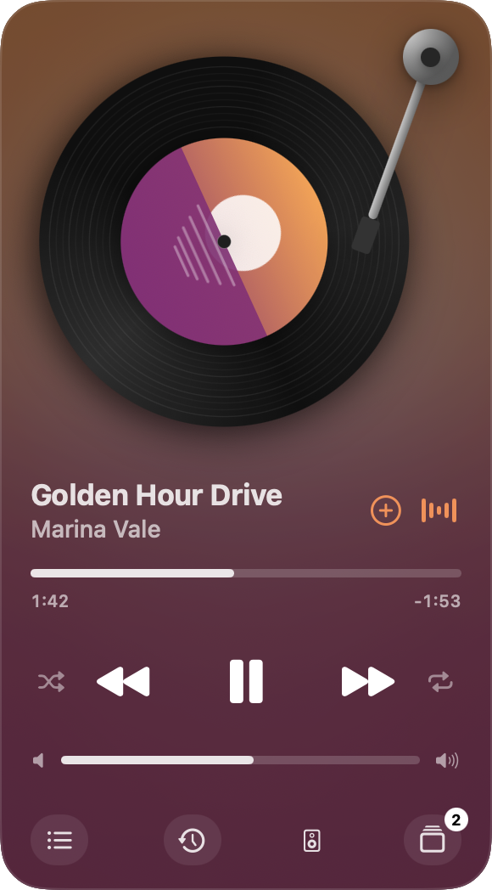 | 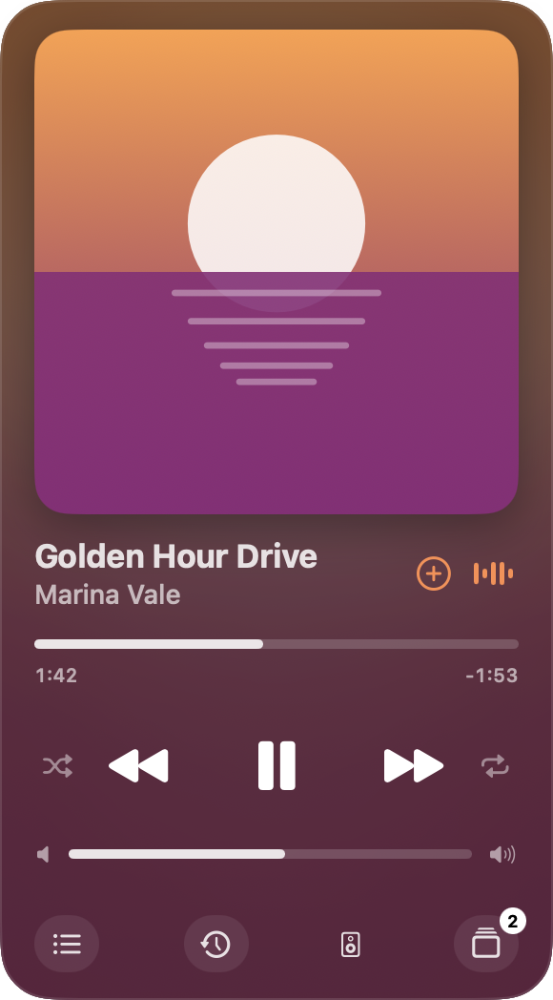 |
| **Mini player** | 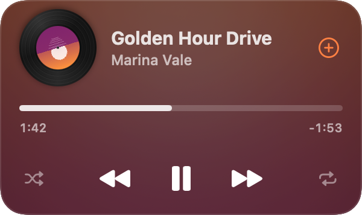 | 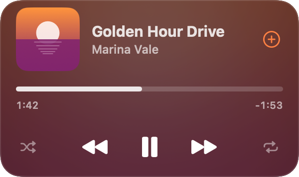 |

A desktop music widget in three sizes (small, medium, large) and a **mini player** in the menu bar, each with the vinyl or the normal cover. See [Music Widget and menu bar player](#music-widget-and-menu-bar-player).

### Stay Awake

<p><br></p>

Keep the Mac awake from its Lagoon, with **⌥⌘A** or with the cup button in the Lagoons bar.

### Pomodoro

<p><br></p>

Timers and a Pomodoro focus timer (the brain button), with the time on the closed island.

### Window Snap

<p>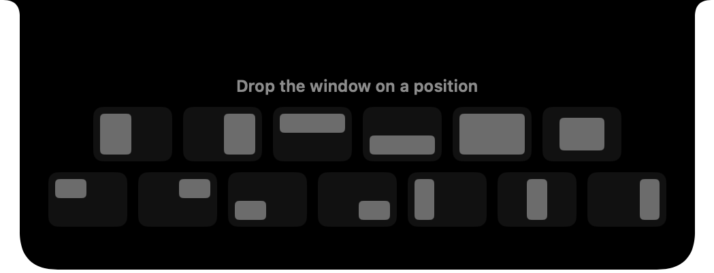</p>

Drag a window to the notch and drop it on a layout, or use **⌃⌥** shortcuts.

### Termi-Notch

<p></p>

Shell commands in the notch: saved commands as buttons and a command line, with the output on the island.

### Audio Control

<p></p>

A volume slider for every app that is playing (0–200 %).

### System Stats

<p></p>

Live CPU, memory, GPU, disk, network, battery and temperature.

### Agents

<p><br> </p>

Follow Claude Code, Codex, Gemini CLI and GitHub Copilot sessions — working, waiting for you, subagents — plus usage and plan limits.

To show the Claude plan limits, Lagoon reads your Claude Code login from the macOS Keychain. It never asks on its own: if macOS needs your permission, the usage panel shows **Allow access** — click it once and choose **Always Allow**.

### Microsoft Teams / Zoom

<p><br></p>

Meeting controls on the island: mute, camera, screen sharing and leave, with the real state of the app.

### Chrome / Safari / Firefox Downloads

<p><br></p>

Download progress on the island and the list in the Downloads Lagoon.

Plugins are either **native** (Swift, shipped with the app and switched on by the plugin) or **JavaScript** (a folder with `manifest.json` and `plugin.js`, running in a sandboxed JavaScriptCore context with a permission-checked `lagoon` API). You can also load your own JavaScript plugin from a folder in **Settings → Plugins**.

## Music Widget and menu bar player

<p>
  
  
</p>

- **Three sizes** (small pill, medium square, large portrait), on the desktop or floating above windows.
- **Themes**: album colour, black, Liquid Glass, clear glass, dynamic glass.
- Large widget: progress, volume, output, **Up Next**, **recents** and **players**.
- **Vinyl or normal cover** (the vinyl spins slow, medium or fast); tapping the cover plays/pauses.
- **Menu bar player**: artwork and play/pause in the menu bar; click to open a small player under the island.
- Right-click the widget for all its options.

## Spotify

Basic control (play, pause, skip, artwork) works out of the box through AppleScript, with no setup.

The extras — **Like**, **Up Next**, **Recents** and **repeat one** — use the Spotify Web API, which needs a free Spotify app of your own (Spotify only lets each app connect accounts its owner allows, so Lagoon can't ship one for everyone). It takes about 2 minutes:

1. Open the [Spotify Developer Dashboard](https://developer.spotify.com/dashboard), sign in with your Spotify account and click **Create app**.
2. Give it any name and description, tick **Web API**, and under **Redirect URIs** add exactly `http://127.0.0.1:8957/callback`. Save.
3. Copy the app's **Client ID**.
4. In Lagoon, open **Settings → Activities → Spotify**, paste the Client ID and click **Connect to Spotify**.

Lagoon asks Spotify as little as possible (Spotify limits how many requests an app can make; if it asks Lagoon to wait, the island tells you until when).

## Keyboard shortcuts and gestures

| Shortcut | Action |
|---|---|
| **⌥⇥** | Action Ring (changeable) |
| **⌥⌘T** | Start a quick timer |
| **⌘ + click** on the notch | Start a quick timer |
| **⌥⌘R** | Start / stop screen recording |
| **⌥⌘V** | Clipboard history |
| **⌥⌘A** | Stay Awake on / off |
| Two-finger swipe on the open island | Next / previous Lagoon |
| Right-click the island | Quick options |

Shortcuts can be turned off in Settings.

## Settings

Open from the gear in the Lagoons bar, the island's right-click menu or the menu bar icon. While Settings are open the island stays open, so you see changes live.

- **General** — language (English / Portuguese / system), open at login, updates, credits and licenses, open on hover, delays, Lagoon to open, shortcuts.
- **Displays** — which screens get an island and where.
- **Appearance** — style (black, Liquid Glass), accent colour, closed island width/height/distance from the top, open island size and corners, bubble size and count, Lagoons bar always visible or on hover, animation speed, Lagoon order.
- **Activities** — what the closed island shows, music options (vinyl, Sneak Peek), Spotify, weather, notifications, HUD.
- **Tools** — Clip, clipboard, converter and timer options.
- **Plugins** — installed plugins and the Marketplace.
- **Permissions** — status of every permission with a button to grant it.

## Privacy

Lagoon runs on your Mac. It has no account and no analytics. Data only leaves your Mac for the features that need it:

| Feature | Talks to |
|---|---|
| Weather | [Open-Meteo](https://open-meteo.com) (free, no account), with your city or approximate location |
| Spotify extras | Spotify, with your login and your own Spotify app's Client ID |
| Shortcuts link icons | The website of each link (to fetch its icon) |
| Agents usage (optional) | Anthropic, with your Claude Code login; GitHub, with your `gh` login |
| iCloud link | Your iCloud Drive |
| Updates | GitHub (the list of versions and the update itself) |

Logins (Spotify) are stored in the macOS Keychain.

## Troubleshooting

- **A feature does nothing** — check **Settings → Permissions**; after granting Accessibility you may need to restart Lagoon.
- **macOS says Lagoon can't be opened** — install it with the Terminal command above, or open **System Settings → Privacy & Security** and click **Open Anyway**.
- **Browser tabs don't show in the music player** — allow AppleScript control of the browser when macOS asks, and turn on *Allow JavaScript from Apple Events* (Chrome-based: *View → Developer*; Safari: *Settings → Advanced → Show features for web developers*, then *Develop*).
- **Spotify Like/Queue/Recents stopped working** — Spotify may have asked Lagoon to wait (the island shows until when), or you need to connect the account again after an update that added a permission.
- **"This Spotify account isn't allowed for the Client ID"** — the Client ID in Settings must be from a Spotify app you created yourself (see [Spotify](#spotify)).
- **macOS keeps asking for the "Claude Code-credentials" password** — update Lagoon: it no longer asks on its own. Use **Allow access** in the Agents usage panel and choose **Always Allow**.
- **Something froze or crashed** — look at `~/Library/Logs/Lagoon.log` and open an issue with the last lines.

## Acknowledgements

Lagoon uses these open-source components and services (full notices in the app: **Settings → General → Credits and licenses**):

| | | License |
|---|---|---|
| [mediaremote-adapter](https://github.com/ungive/mediaremote-adapter) | Reads what is playing (macOS 15.4+) | BSD 3-Clause |
| [Sparkle](https://sparkle-project.org) | Automatic updates | MIT |
| [Open-Meteo](https://open-meteo.com) | Weather data | CC BY 4.0 |

## Feedback

Found a bug or have an idea? **[Open an issue](https://github.com/jpclopes99/Lagoon/issues)**: problems are fixed and new features ship in new releases.

## License

**All rights reserved.** Lagoon is free to download, install and use on your own Macs, but it is **not open source**: the source code is not published, and you may not copy, modify or redistribute the app without the author's written permission. See [LICENSE](LICENSE) for the full terms. Third-party components are not covered by it and keep their own licenses: [mediaremote-adapter](https://github.com/ungive/mediaremote-adapter) (BSD 3-Clause) and [Sparkle](https://sparkle-project.org) (MIT); weather data comes from [Open-Meteo](https://open-meteo.com) (CC BY 4.0). See [Acknowledgements](#acknowledgements).
